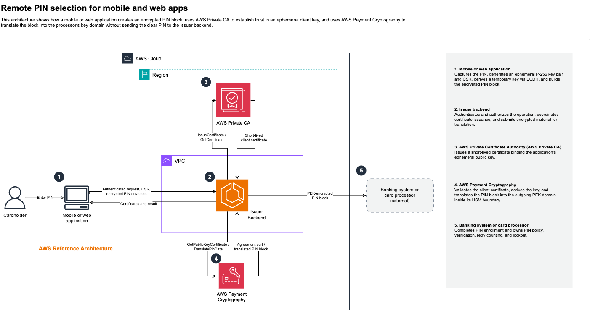

# Remote PIN selection demo

This is the companion demo for the AWS blog post
**Building remote PIN selection for mobile and web apps**.
<!-- TODO: add the blog post URL once published. -->
The post explains the design; this repository lets you run it.

A Flutter web app lets a cardholder choose a PIN. The app encrypts the PIN
block under a key derived with ECDH. The Go issuer backend never sees the
clear PIN: it has AWS Private CA certify the app's ephemeral key, then calls
AWS Payment Cryptography to translate the PIN block into the PIN encryption
key (PEK) domain of the banking system or card processor.



> [!WARNING]
> This is a demo. Use synthetic PANs and test PINs only. It has no user
> authentication, and it is not a PCI-assessed or production-ready system.
> See [SECURITY.md](SECURITY.md).

## What's in the repository

| Path | What it is |
|---|---|
| [`terraform/`](terraform/) | AWS Private CA, Payment Cryptography keys, and the DynamoDB table |
| [`frontend/`](frontend/) | Flutter web app: ephemeral key and CSR, ECDH, KDF, ISO-0 PIN block encryption |
| [`backend/`](backend/) | Go issuer backend: operations, AWS Private CA, `TranslatePinData`, processor handoff |
| [`backend/processor/`](backend/processor/) | **Processor stand-in**: PVV generation, verifier storage, PIN verification |

### Where each step of the blog post lives

| Blog post step | Code |
|---|---|
| Trust setup: Private CA and Payment Cryptography keys | [`terraform/main.tf`](terraform/main.tf) |
| Trust setup: import the CA certificate into Payment Cryptography | [Step 2](#2-import-the-ca-certificate-into-aws-payment-cryptography) below |
| Authorize the operation, return the agreement certificate | [`handler/api.go`](backend/handler/api.go) `BeginOperation`, [`operation/`](backend/operation/operation.go) |
| Generate the P-256 key pair and CSR | [`crypto_service.dart`](frontend/lib/services/crypto_service.dart) `generateEphemeralKeyAndCsr` |
| `IssueCertificate` and `GetCertificate` | [`ca/privateca.go`](backend/ca/privateca.go) |
| ECDH, KDF, and PIN block encryption | [`crypto_service.dart`](frontend/lib/services/crypto_service.dart) `encryptPin` |
| Send only the encrypted PIN envelope | [`api_service.dart`](frontend/lib/services/api_service.dart) `prepareEnvelope` |
| Replay prevention | [`operation/operation.go`](backend/operation/operation.go) `Claim` |
| `TranslatePinData` | [`apc/translate.go`](backend/apc/translate.go) |
| Deliver the translated block to the banking system | [`handler/api.go`](backend/handler/api.go) `submit`, [`processor/`](backend/processor/processor.go) |

### The processor stand-in

In production, the issuer backend's job ends when it hands the PEK-encrypted
PIN block to the banking system or card processor. The processor generates
and stores the PIN verifier, and verifies PINs when the card is used.

So that you can see those steps, this demo runs them itself in
[`backend/processor/`](backend/processor/): it calls `GeneratePinData` to
compute a Visa PIN verification value (PVV), stores the PVV in DynamoDB, and
calls `VerifyPinData` on the **Validate PIN** page. That code is labeled
*processor side* throughout and is not part of an issuer backend.

## Prerequisites

- An AWS account, and credentials that can create AWS Private CA, AWS Payment
  Cryptography, and DynamoDB resources, in a
  [Region where AWS Payment Cryptography is available](https://docs.aws.amazon.com/general/latest/gr/payment-cryptography.html)
- [AWS CLI v2](https://docs.aws.amazon.com/cli/latest/userguide/getting-started-install.html)
- [Terraform](https://developer.hashicorp.com/terraform/install) 1.5 or later
- [Go](https://go.dev/doc/install) 1.24 or later
- [Flutter](https://docs.flutter.dev/get-started/install) 3.44.4 or later
  (Dart 3.10 or later), and a web browser

Run the commands below from the repository root unless a step says otherwise.
They use your default AWS credentials; to use a named profile, first run
`export AWS_PROFILE=<profile>`.

## 1. Create the AWS resources

```bash
cd terraform
terraform init
terraform apply                          # Region defaults to us-east-1
# terraform apply -var region=eu-west-1  # or choose another Region
```

Terraform creates:

| Resource | Purpose |
|---|---|
| AWS Private CA, `SHORT_LIVED_CERTIFICATE` mode, `EC_prime256v1` | Issues the app's client certificate |
| `ECC_NIST_P256` key-agreement key | The service's side of ECDH |
| `TDES_2KEY` PIN encryption key (PEK) | The processor's key domain |
| `TDES_2KEY` Visa PIN verification key | *Processor stand-in*: PVV generation |
| DynamoDB table `remote-pin-demo-verifiers` | *Processor stand-in*: PVV storage |
| KMS key `alias/remote-pin-demo-verifiers` | *Processor stand-in*: encrypts the verifier table |

The Private CA is created as a root CA and activated by signing and installing
its own certificate.

> [!IMPORTANT]
> These resources are billed while they exist, and some charges accrue per
> request. [Clean up](#9-clean-up) when you are done.
>
> | Service | Charges | Reference |
> |---|---|---|
> | AWS Private CA | Monthly fee for the CA in short-lived certificate mode, plus each certificate issued (one per PIN operation) | [Pricing](https://aws.amazon.com/private-ca/pricing/), [short-lived certificates](https://docs.aws.amazon.com/privateca/latest/userguide/short-lived-certificates.html) |
> | AWS Payment Cryptography | Each active key per month (four, including the imported CA key), plus each API request | [Pricing](https://aws.amazon.com/payment-cryptography/pricing/) |
> | AWS KMS | The customer managed key per month, plus requests DynamoDB makes on your behalf | [Pricing](https://aws.amazon.com/kms/pricing/) |
> | Amazon DynamoDB | On-demand reads and writes, table storage, and point-in-time recovery backup storage | [On-demand pricing](https://aws.amazon.com/dynamodb/pricing/on-demand/), [point-in-time recovery](https://docs.aws.amazon.com/amazondynamodb/latest/developerguide/Point-in-time-recovery.html) |

## 2. Import the CA certificate into AWS Payment Cryptography

Payment Cryptography accepts the app's certificate only if it chains to a CA
certificate that you imported as a root certificate public key. The Terraform
AWS provider has no resource for `ImportKey`, so run it with the AWS CLI. Stay
in the `terraform/` directory:

```bash
export AWS_REGION="$(terraform output -raw region)"

# ImportKey takes the PEM certificate base64-encoded.
CA_PEM_B64="$(terraform output -raw private_ca_certificate_pem | base64 | tr -d '\n')"

CA_KEY_ARN="$(aws payment-cryptography import-key \
  --key-material "{
    \"RootCertificatePublicKey\": {
      \"KeyAttributes\": {
        \"KeyAlgorithm\": \"ECC_NIST_P256\",
        \"KeyClass\": \"PUBLIC_KEY\",
        \"KeyModesOfUse\": {\"Verify\": true},
        \"KeyUsage\": \"TR31_S0_ASYMMETRIC_KEY_FOR_DIGITAL_SIGNATURE\"
      },
      \"PublicKeyCertificate\": \"$CA_PEM_B64\"
    }
  }" \
  --tags Key=Project,Value=remote-pin-demo \
  --query Key.KeyArn --output text)"

echo "$CA_KEY_ARN"
```

The backend passes this key to `TranslatePinData` as
`CertificateAuthorityPublicKeyIdentifier`.

## 3. Configure the backend

Still in `terraform/`, write the resource identifiers to `backend/.env`
(ignored by Git), then add the imported CA key:

```bash
terraform output -raw backend_env > ../backend/.env
echo "APC_CA_PUBLIC_KEY_ARN=$CA_KEY_ARN" >> ../backend/.env
cd ..
```

[`backend/.env.example`](backend/.env.example) describes every setting.

## 4. Start the backend

In a new terminal:

```bash
cd backend
set -a; . ./.env; set +a   # export the settings from .env
go run .
```

The first `go run` downloads the Go modules. The backend listens on
<http://localhost:8080>, on the loopback interface only (`BACKEND_ADDR`). It
answers browser requests only from the origins in `ALLOWED_ORIGINS`, which
default to the web app's address in step 5. If you serve the web app
elsewhere, add its origin there.

## 5. Start the web app

In a second terminal:

```bash
cd frontend
flutter pub get
flutter run -d web-server --web-port 8081 \
  --dart-define=API_BASE_URL=http://localhost:8080
```

Flutter compiles the app and serves it. When it prints
`lib/main.dart is being served at http://localhost:8081`, open that URL in
your browser. `API_BASE_URL` is compiled into the app, so if your backend runs
elsewhere, pass its URL there and restart `flutter run`.

<details>
<summary>Run both with Docker Compose instead</summary>

With [Docker](https://docs.docker.com/get-docker/) and Compose installed, you
can replace steps 4 and 5 with:

```bash
docker compose up --build
```

Compose mounts `~/.aws` read-only and passes `AWS_PROFILE` through. It
publishes both ports on `127.0.0.1` only. Open <http://localhost:8081>.

</details>

## 6. Try it

1. Select **Set PIN**. Enter a synthetic PAN, such as `4000123456789010`, and
   a 4-6 digit test PIN.
2. After the PIN is set, select **Validate this PIN** and enter the same PIN.
   The result is **PIN is valid**.
3. Validate again with a different PIN. The result is **PIN is not valid**.

Each submission is a new operation, with a fresh key pair, a fresh
certificate, and fresh `SharedInformation`.

To run the same checks from the command line, including a replay attempt that
the backend refuses:

```bash
cd frontend
API_BASE_URL=http://localhost:8080 dart run tool/pin_smoke.dart
```

## 7. Follow the flow in the backend logs

Set `LOG_LEVEL=debug` in `backend/.env` and restart the backend. Each request
logs numbered steps, correlated by operation ID:

```text
DEBUG flow=pin-set op=5f0c… step=01 component=backend message="encrypted PIN envelope received"
DEBUG flow=pin-set op=5f0c… step=02 component=backend message="operation claimed; envelope cannot be replayed"
DEBUG flow=pin-set op=5f0c… step=03 component=payment-cryptography message="translating ECDH PIN block to the PEK (TranslatePinData)"
DEBUG flow=pin-set op=5f0c… step=04 component=backend message="handing PEK-encrypted PIN block to the processor"
DEBUG flow=pin-set op=5f0c… step=05 component=processor message="generating Visa PVV from the PEK-encrypted PIN block (GeneratePinData)"
DEBUG flow=pin-set op=5f0c… step=06 component=processor message="storing the PVV verifier record in DynamoDB"
DEBUG flow=pin-set op=5f0c… step=07 component=backend message="operation complete"
```

To also print the synthetic values at each step (PAN, the PIN block before and
after translation, the key check value, and the PVV), set
`DEMO_LOG_SENSITIVE_VALUES=true` as well. The clear PIN is never logged,
because the backend never has it. Never enable this option with real card
data.

## 8. Inspect the stored PVV record

After you set a PIN, look at what the processor stand-in stored:

```bash
aws dynamodb get-item \
  --table-name remote-pin-demo-verifiers \
  --key '{"pan": {"S": "4000123456789010"}}'
```

The record holds the PVV, the PIN verification key reference and index needed
to verify against it, a version that increments on every reset, and
timestamps. It contains no PIN and no PIN block. In production, the processor
owns this data, and it would be keyed by a token rather than the PAN.

## 9. Clean up

Stop the backend and the web app. Then, from the repository root, delete the
imported CA key, which Terraform does not manage:

```bash
set -a; . backend/.env; set +a   # sets AWS_REGION and APC_CA_PUBLIC_KEY_ARN
aws payment-cryptography delete-key \
  --key-identifier "$APC_CA_PUBLIC_KEY_ARN" \
  --delete-key-in-days 3
```

Then delete everything Terraform created, and the local settings file:

```bash
(cd terraform && terraform destroy)
rm backend/.env
```

`terraform destroy` schedules the private CA for deletion with a 7-day restore
window, schedules the Payment Cryptography keys for deletion after 3 days,
schedules the table's KMS key for deletion after 7 days, and deletes the
DynamoDB table with its verifier records.

## API

All endpoints take and return JSON. Every PIN operation is three calls bound to
one single-use `operation_id`.

| Call | Request | Response |
|---|---|---|
| `POST /api/operations` | `type` (`pin-set` or `pin-validate`), `pan` | `operation_id`, `expires_at`, `agreement_certificate_pem` |
| `POST /api/csr-sign` | `operation_id`, `csr_pem` | `certificate_pem` |
| `POST /api/pin/set` | the envelope below | `success`, `version` |
| `POST /api/pin/validate` | the envelope below | `success`, `valid` |

The encrypted PIN envelope:

```json
{
  "operation_id": "<from /api/operations>",
  "pan": "4000123456789010",
  "encrypted_pin_block": "<16 hexadecimal characters>",
  "client_cert_pem": "<from /api/csr-sign>",
  "shared_information": "<64 hexadecimal characters, no 00 bytes>"
}
```

An operation expires after 5 minutes and accepts one CSR and one envelope. A
reused, expired, or mismatched operation returns `409`. A service failure
returns `502` with a generic message; details go to the backend log.

## Backend IAM permissions

The backend needs only these runtime permissions. Replace the placeholders
with the values in `backend/.env`.

```json
{
  "Version": "2012-10-17",
  "Statement": [
    {
      "Sid": "IssueEndEntityCertificatesOnly",
      "Effect": "Allow",
      "Action": "acm-pca:IssueCertificate",
      "Resource": "<PRIVATE_CA_ARN>",
      "Condition": {
        "StringEquals": {
          "acm-pca:TemplateArn": "arn:aws:acm-pca:::template/EndEntityCertificate/V1"
        }
      }
    },
    {
      "Sid": "GetIssuedCertificates",
      "Effect": "Allow",
      "Action": "acm-pca:GetCertificate",
      "Resource": "<PRIVATE_CA_ARN>"
    },
    {
      "Sid": "TranslatePinBlocks",
      "Effect": "Allow",
      "Action": [
        "payment-cryptography:GetPublicKeyCertificate",
        "payment-cryptography:TranslatePinData"
      ],
      "Resource": [
        "<APC_KEY_AGREEMENT_KEY_ARN>",
        "<APC_PEK_ARN>",
        "<APC_CA_PUBLIC_KEY_ARN>"
      ]
    },
    {
      "Sid": "ProcessorStandInOnly",
      "Effect": "Allow",
      "Action": [
        "payment-cryptography:GeneratePinData",
        "payment-cryptography:VerifyPinData"
      ],
      "Resource": ["<APC_PEK_ARN>", "<APC_PVK_ARN>"]
    },
    {
      "Sid": "ProcessorStandInVerifierTable",
      "Effect": "Allow",
      "Action": ["dynamodb:GetItem", "dynamodb:UpdateItem"],
      "Resource": "arn:aws:dynamodb:<region>:<account>:table/remote-pin-demo-verifiers"
    },
    {
      "Sid": "ProcessorStandInVerifierTableKey",
      "Effect": "Allow",
      "Action": ["kms:Decrypt", "kms:GenerateDataKey", "kms:DescribeKey"],
      "Resource": "<VERIFIER_TABLE_KMS_KEY_ARN>",
      "Condition": {
        "StringEquals": {"kms:ViaService": "dynamodb.<region>.amazonaws.com"}
      }
    }
  ]
}
```

The `acm-pca:TemplateArn` condition limits the backend to issuing end-entity
certificates, so it cannot mint CA certificates. `GetCertificate` is in its own
statement because the condition key does not apply to it.

## Tests

The tests use fakes and need no AWS access.

```bash
(cd backend && go test ./...)
(cd frontend && flutter pub get && flutter analyze && flutter test)
```

The DynamoDB store also has an integration test against DynamoDB Local; see
[`docker-compose.local.yaml`](docker-compose.local.yaml).

## Security

See [SECURITY.md](SECURITY.md) for how to report a vulnerability and for the
demo's known limitations.

## License

This library is licensed under the MIT-0 License. See the [LICENSE](LICENSE)
file.
